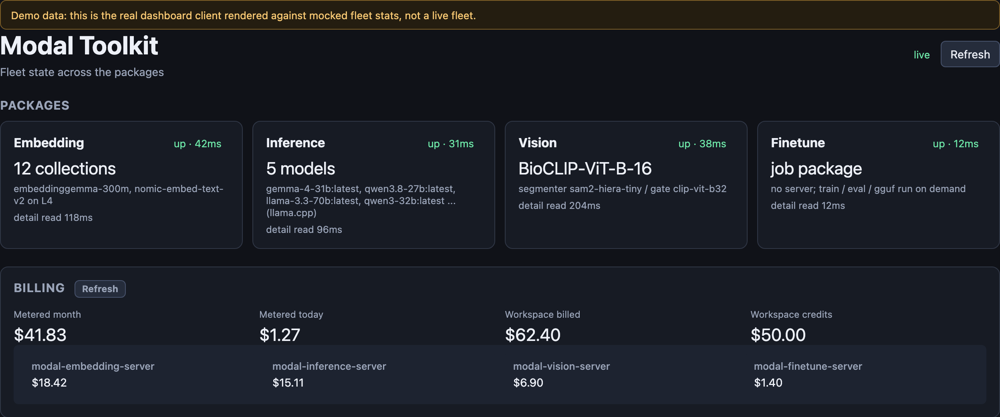
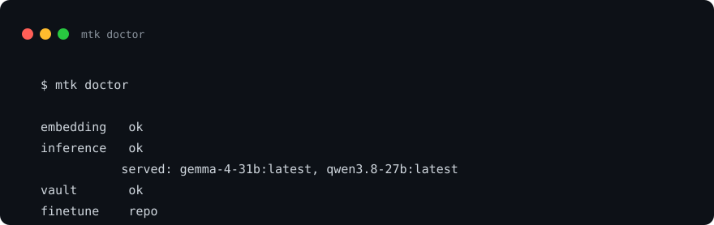
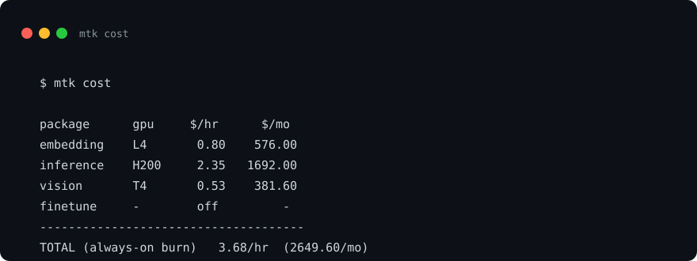
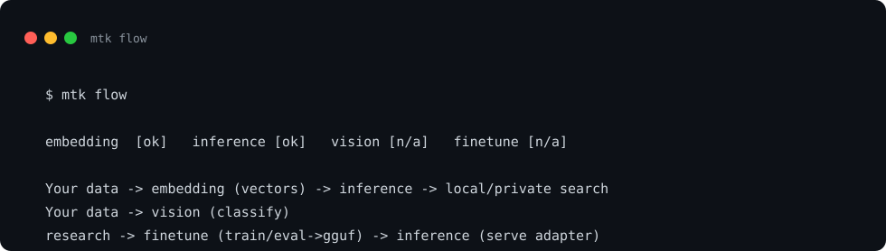
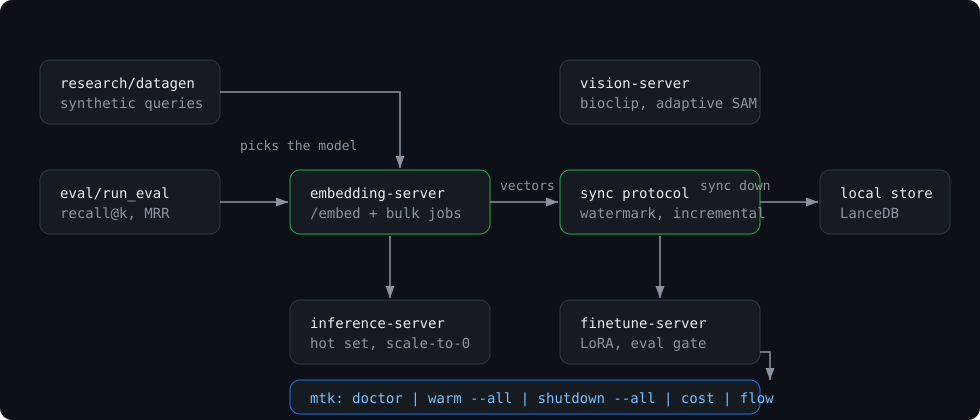

# Modal Toolkit

One operator CLI for the **Modal Toolkit**: standalone GPU/research packages that work alone or together: embeddings, LLM inference, vision, LoRA fine-tune, and the hosted vault + MCP memory plane, plus the eval harness that starts the lifecycle.

[](LICENSE)
[](https://www.python.org/)
[](https://github.com/sponsors/kylebrodeur)

---

### Production Support, Operator Kit & Architecture Services

The Modal Toolkit projects remain open-source and free to use. For production deployments and team operations, these commercial options are available:

- **[Modal Production Operator Kit ($29)](https://github.com/sponsors/kylebrodeur):** A version-locked vendor installer, a real `mtk` overlay example, retrieval and fine-tune data recipes, a dated cost worksheet, and a Modal Vault MCP client installer.
- **[Modal Architecture, Cost & Safety Audit ($147)](https://github.com/sponsors/kylebrodeur):** A written audit of one Modal application or deploy tree, with prioritized findings and recommendations.
- **[Modal Vendor-Overlay Refactor ($247)](https://github.com/sponsors/kylebrodeur):** One ready-to-review pull request that moves one supported Modal package into a vendored overlay.
- **[GitHub Sponsors ($9-$389/mo or one-time)](https://github.com/sponsors/kylebrodeur):** Monthly support, kit licenses, architecture calls, and retainer hours. Every tier's exact benefits are on that page.


---

## Docs

- [Quickstart](docs/quickstart.md): the project flow (init, pull, deploy) with the overlay file format.
- [Runbook](docs/RUNBOOK.md): the fleet-level operator surface (doctor, warm, shutdown, cost, the vault lane, troubleshooting).

## The packages

This CLI orchestrates the packages; each is its own standalone repo and can be used without the toolkit:

- **[modal-embedding-server](https://github.com/kylebrodeur/modal-embedding-server):** GPU-backed embeddings with a monotonic sync protocol for private-first search.
- **[modal-inference-server](https://github.com/kylebrodeur/modal-inference-server):** OpenAI-compatible LLM inference with hot-set routing and scale-to-zero.
- **[modal-vision-server](https://github.com/kylebrodeur/modal-vision-server):** Generic vision classification: pick your model (open_clip or transformers weights), your segmenter (SAM 2.1 or none), and your fast gate (self, cheap CLIP, deterministic script, or external endpoint). The BioCLIP plant stack ships as the example card.
- **[modal-vault-server](https://github.com/kylebrodeur/modal-vault-server):** Hosted Obsidian vault + MCP memory plane: server-side clone via Headless Sync, searchable by MCP-speaking agents.
- **[modal-finetune-server](https://github.com/kylebrodeur/modal-finetune-server):** Profile-driven LoRA fine-tune and GGUF pipeline with an honest eval gate.
- **[modal-victoriametrics-server](https://github.com/kylebrodeur/modal-victoriametrics-server):** The metrics store: single-node VictoriaMetrics on Modal, CPU-only, scale-to-zero, Basic-Auth-gated. Every endpoint is protected; the `mtk metrics` writer's drop-in target.
- **[modal-toolkit](https://github.com/kylebrodeur/modal-toolkit):** One operator CLI (`mtk`) that runs the fleet: `doctor`, `secrets`, `warm --all`, `shutdown --all`, `cost`, `flow`, `dashboard`.
- **[modal-shared-libs](https://github.com/kylebrodeur/modal-shared-libs):** the family's shared library home: the lifecycle hooks seam (`libs/hooks.py`) vendored verbatim into every package, refreshed by `mtk libs sync`.
- **[embed-eval-on-your-vault](https://github.com/kylebrodeur/embed-eval-on-your-vault):** the eval-first pattern (benchmark embedding models on your own data before you deploy) as a single-file, zero-dependency harness.

## What `mtk` adds

A single entry point for **fleet-level commands** that don't belong in any one package:

| Command | Purpose |
| :--- | :--- |
| `mtk setup` | Write the shared config (`~/.config/modal-toolkit/config.json`, mode 600) |
| `mtk config` | Inspect + validate the shared config |
| `mtk status [--no-net]` | One table: configured/enabled/secrets/reachable per package (`--no-net` = config-only glance) |
| `mtk doctor [--pkg ... --json]` | Health + drift across all packages in one shot (mark per package: ok / unhealthy / unreachable / cold / repo) |
| `mtk warm [--pkg ... --all]` | Cold-start a package's GPU worker |
| `mtk shutdown [--pkg ... --all]` | Scale GPU(s) to zero now (the `vision` package's path is a real `modal app stop` - undeploy, not scale-to-zero - and is arm-gated: typed confirmation, or `--force` + `MTK_ALLOW_APP_STOP=1`) |
| `mtk cost` | Per-package + blended always-on GPU-hour view |
| `mtk flow` | The ecosystem flowchart, rendered against live state |
| `mtk dashboard deploy \| stop \| logs \| url` | The fleet dashboard: one CPU app, a card per GPU-serving package |
| `mtk secrets` | Fleet-level Modal Secrets: `check` (drift diff), `create`, `rotate` |
| `mtk metrics` | Push app events/rates to VictoriaMetrics (or InfluxDB) from any package or Modal app; stdlib-only writer + test command |
| `mtk libs sync \| check` | Vendor the family's shared stdlib modules (modal-shared-libs) verbatim into each package; `check` is the md5 parity gate CI runs |

Per-package deep work is declared by each repo's own command manifest
(`server/mtk-commands.toml`); `mtk` mounts one command group per repo that
ships one, so adding a command is a repo-side edit:

| Command | Purpose |
| :--- | :--- |
| `mtk embedding sync \| reindex` | Wrapper for the embedding server's own commands |
| `mtk inference <command> ...` | Passthrough to the inference repo's own `modal-inference` CLI |
| `mtk vision deploy \| warm` | Wrapper for the vision server's own commands |
| `mtk finetune train \| eval \| gguf` | Wrapper for the finetune pipeline's own commands |
| `mtk vault status \| sync \| pull-only \| ...` | Passthrough to `ob` inside the vault container (never local sync) |

The groups above mount only when the package's repo is present in the
workspace (and `mtk doctor` lists what each declares); a toolkit-only clone
offers just the fleet-level commands.

## The fleet dashboard

One CPU-only Modal app (`mtk dashboard deploy`) that shows the GPU
packages (embedding, inference, vision, finetune) plus the metrics store
(vm) as cards, one adapter
each. Each adapter answers two questions: an unauthenticated
health probe for the state pill and one authenticated read for the
headline. The probes differ per card, matching what each server
actually exposes:

- **embedding:** unauth `/health`, then `GET /stats` for the headline
  (collections count + loaded models).
- **inference:** no `/health` exists: the adapter probes unauth
  `/api/tags` first and falls back to unauth `/v1/models`; the headline
  is the served-alias list (the hot set) from the authed read.
- **vision:** unauth `/health`, then the authed headline comes from the
  same `/health` payload (model + segmenter + fast gate); the identify
  surface is POST-only and never probed.
- **finetune:** a job package with no server and no `/health`: the card
  states that nature and makes no remote probe.

Each config entry can carry an optional `card_type` field, so multiple
instances of one package type (two independent `modal-inference-server`
deployments, for example) each render as their own card under a
distinct key instead of colliding. Omit it and the pre-existing
contract is unchanged: the entry's own key is its card type.

Session auth is its own bearer credential
(`MODAL_TOOLKIT_DASHBOARD_TOKEN`, hash-fragment autologin supported).
Billing is fleet-wide: metered month/today, workspace billed vs
credits, per-app split, and a workspace-disabled banner.

```bash
modal secret create modal-toolkit-dashboard-secret MODAL_TOOLKIT_DASHBOARD_TOKEN=$(openssl rand -hex 32)
mtk dashboard deploy   # builds + deploys the CPU app (config Volume reads dashboard-config.json if present)
# open the printed URL ... or visit /_toolkit/login#key=<credential>
mtk dashboard stop     # undeploys the dashboard app (modal app stop); arm-gated - typed confirmation or --force + MTK_ALLOW_APP_STOP=1
```

Deploying and keying the dashboard is per-operator: create your own
secret, deploy under your own workspace. Nothing in the packages
depends on this app existing.

The dashboard is read-only across packages (single-writer per package)
and links to each package's own deep surface (the inference dashboard
keeps runtime tuning, catalog, and slot telemetry).



## The fleet at a glance





## The lifecycle



## Quick Start

Install from PyPI (needs [uv](https://docs.astral.sh/uv/) and git; the Modal CLI is
needed for deploys: `uv tool install modal` then `modal setup`):

```bash
uv tool install modal-toolkit      # or: uvx --from modal-toolkit mtk --help
```

Then set up once, create a project, and deploy a package from it:

```bash
mtk setup --repos-root ~/repos     # shared config; token entered at the prompt
mtk init my-project                # scaffold a project; checks prerequisites and your account
cd my-project
mtk pull vault                     # clone the package repo into ~/repos
mtk deploy vault                   # preflight the overlay, confirm secrets, deploy
mtk doctor                         # health across the fleet
```

The full walkthrough, including the overlay file format, is in
[docs/quickstart.md](docs/quickstart.md). Each server has its own quickstart and
how-to, linked from the packages list above, and the metrics store too:
[modal-victoriametrics-server quickstart](https://github.com/kylebrodeur/modal-victoriametrics-server/blob/main/docs/quickstart.md)
and
[how-to](https://github.com/kylebrodeur/modal-victoriametrics-server/blob/main/docs/how-to.md).

## Configuration

One file, one section per package. Tokens are never printed by any `mtk` command.

```
~/.config/modal-toolkit/config.json
{
  "embedding":  {"base_url": "...", "token": "...", "model": "...", "dim": 768},
  "inference":  {"base_url": "...", "token": "...", "alias": "...", "dashboard_url": "...", "dashboard_token": "..."},
  "vision":     {"base_url": "...", "token": "...", "model": "...", "gpu": "T4"},
  "finetune":   {"base_model": "...", "adapter_repo": "...", "hf_user": "..."},
  "coding":     {"base_url": "...", "token": "...", "alias": "..."},
  "vault":      {"base_url": "...", "token": "..."},
  "vm":         {"base_url": "...", "auth": "user:password"},
  "repos":      {"root": "/path/to/your/repos-dir"}
}
```

Override anything via env (no config edit required):

- `MODAL_TOOLKIT_CONFIG`: use a different config file path
- `MODAL_TOOLKIT_REPOS`: where the sibling package repos live
- `MODAL_BASE_URL`, `MODAL_PROXY_TOKEN`: the standard per-package overrides
- `MODAL_VISION_GPU`, `MODAL_VISION_MODEL`, `MODAL_FINETUNE_BASE`, `MODAL_FINETUNE_ADAPTER`, etc.

## The vault lane (`mtk vault`)

`mtk vault status | sync | pull-only | sync-on-write | mirror-remote |
continuous | list-remote | list-local | config | logs | exec` is an
operator passthrough to `ob` running INSIDE the `modal-vault-server`
container. The `ob` binary, its login state, and the clone all live in
that container, Volume-backed at `/vault`: every command uses
`modal container exec` against a `modal-vault-server` container id
(waking the scale-to-zero app first) and never syncs, clones, or holds
vault state on the local machine. `pull-only` switches the clone to
pull-only mode; `sync` is the bidirectional mode. One gate applies to
every command: the vault section's `base_url` in the toolkit config.

## Cost model

Modal bills for GPU *time*, by the second, never per token. `mtk cost` reports always-on burn per package and the fleet total, using Modal's published GPU rates (per-second list prices at [modal.com/pricing](https://modal.com/pricing), converted to an hourly figure; read 2026-10-22):

```
H200: $4.54/hr    B200: $6.25/hr    H100: $3.95/hr
L40S: $1.95/hr    A10G: $1.10/hr    L4:   $0.80/hr    T4: $0.59/hr
```

These are list prices, not a quote: Modal's rates change, and a regional multiplier can apply. The **actual cost** depends on how long containers stay warm; the toolkit's job is to make that visible in one call (and `mtk shutdown --all` the escape hatch).

## Examples

| Example | What it shows | Run it |
| :--- | :--- | :--- |
| [`lifecycle-example.py`](examples/lifecycle-example.py) | the full lifecycle as a worked reference: setup → doctor → warm → use → shutdown, with the command for each step | read it; it is the flight path in one file |
| [`modal_cost_discipline_fleet.py`](examples/modal_cost_discipline_fleet.py) | the fleet view: the two Modal primitives behind `mtk doctor` and `mtk shutdown --all`, so you can write your own fleet commands in one file | `modal run examples/modal_cost_discipline_fleet.py` |

One GPU app is easy to keep clean. A fleet of four is where idleness
hides, which is why the fleet example is the capstone: it shows the
always-on burn per app and the fleet total, and then stops everything
at once.

## Projects: vendor copies and deploy overlays

Upstream repos are **SOURCE, never deploy targets.** A project vendors a
tag-pinned copy of each package and deploys it from its own overlay:

```
<project>/vendor/<pkg>-server/       code: git checkout detached at a release tag (read-only, guarded)
<project>/vendor/<pkg>-server/.mtk-vendor.json   provenance: repo, tag, commit
<project>/deploys/<pkg>-server/      decisions: deploy.json (app name, knobs, secret NAMES), deploy.sh, seed.json
```

- **The rule that matters:** the vendored copy is never edited (any drift
  refuses a deploy; `--allow-local-changes` is the recorded override). All
  operator state lives in the overlay.
- **Secret-name invariant:** `deploy.json`'s secret NAMES must match the
  vendored repo's `server/secrets.toml` manifest - the manifest is the source
  of truth `mtk secrets` acts against, so overlays never invent names.
- Reference implementation: `writing-duo/deploys/embedding-server/`
  (private instance of modal-embedding-server, deployed + verified).

## Contributing

See [CONTRIBUTING.md](CONTRIBUTING.md) for ground rules and workflow.

## Part of the Modal Toolkit

Seven repos in the same family: the packages this CLI orchestrates (links in "The packages" above), plus the family's other members listed there too.

## Built on Modal

These packages run on [Modal](https://modal.com), the serverless GPU platform. If you build something with them, share it in the [Modal Slack](https://modal.com/slack) community (`#show-and-tell`). Issues and PRs welcome here on GitHub.

## License

Apache-2.0: see [LICENSE](LICENSE).

---

Built by [Kyle Brodeur](https://kylebrodeur.xyz) · Model-selection deep-dive: [Choose the Right Embedding Model for Your Data](https://kylebrodeur.substack.com/p/choose-embedding-model-for-your-data)
